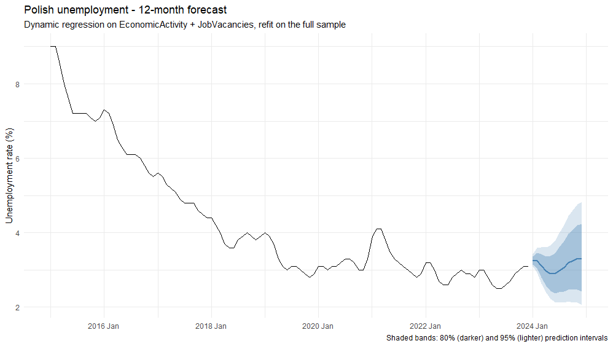
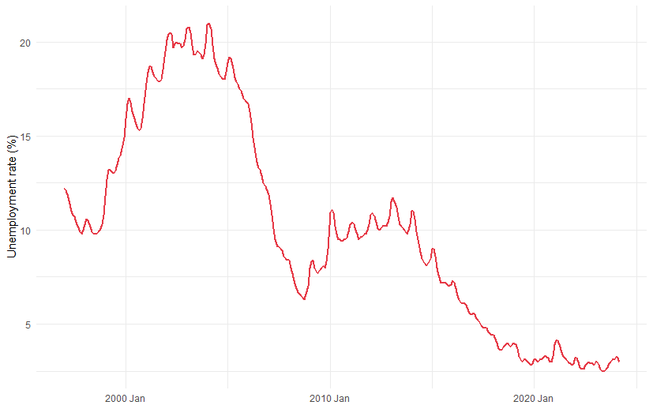
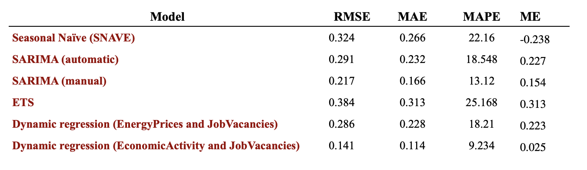

# Forecasting Unemployment in Poland

Time-series forecasting of Poland's monthly unemployment rate (1997–2023) using R and the `fpp3` framework, comparing a seasonal naïve benchmark, SARIMA, ETS and dynamic regression with macroeconomic predictors.

> MSc Business Administration and Data Science, Predictive Analytics exam project (Spring 2026). Group project of 4 students. See [Team & my contribution](#team--my-contribution).



## Research question

**Which modelling approach best captures the dynamics of Poland's unemployment rate and gives the most accurate forecasts?**

## Key results

The **dynamic regression with Economic Activity and Job Vacancies** was the best model on every accuracy metric and every information criterion. Its RMSE is about half that of the other models, and its MAPE (9.2%) is the only one under the 10% "highly accurate" threshold.

Out-of-sample accuracy on a 24-month hold-out (Jan 2022 – Dec 2023), Box-Cox scale:

| Model | RMSE | MAE | MAPE (%) | ME |
|---|---:|---:|---:|---:|
| Seasonal naïve (benchmark) | 0.324 | 0.266 | 22.16 | -0.238 |
| SARIMA (automatic) | 0.291 | 0.232 | 18.55 | 0.227 |
| SARIMA(1,1,0)(0,1,1)[12] (manual) | 0.217 | 0.166 | 13.12 | 0.154 |
| ETS | 0.384 | 0.313 | 25.17 | 0.313 |
| Dynamic regression: EnergyPrice + JobVacancies | 0.286 | 0.228 | 18.21 | 0.223 |
| **Dynamic regression: EconomicActivity + JobVacancies** | **0.141** | **0.114** | **9.23** | **0.025** |

Other findings:
- The **manually identified SARIMA** (from ACF/PACF) clearly beat the automatically selected one.
- **ETS did worse than the naïve benchmark.** It could not handle the series' structural shifts.
- **Predictor choice matters.** With weaker predictors (energy prices), dynamic regression added little over a well-specified univariate model.
- **12-month forecast for 2024:** unemployment stays low and stable at about 3% (2.89%–3.31%), following the usual seasonal pattern.

## Data

Four monthly, not seasonally adjusted series from [FRED](https://fred.stlouisfed.org) (Federal Reserve Bank of St. Louis), Jan 1997 – Dec 2023, 324 observations:

| Variable | FRED code | Role |
|---|---|---|
| UnemploymentRate | `LRHUTTTTPLM156N` | Target |
| EnergyPrice (CPI: Energy, 2015 = 100) | `POLCPIENGMINMEI` | Predictor |
| EconomicActivity (industrial production, 2015 = 100) | `POLPRINTO01IXOBM` | Predictor |
| JobVacancies (unfilled vacancies) | `LMJVTTUVPLM647N` | Predictor |



## Methodology

1. **EDA:** checked missing values and outliers, plotted the series, and ran a correlation analysis.
2. **Transformation:** Box-Cox with the Guerrero λ = 0.315.
3. **Seasonality:** OCSB test and STL decomposition, which showed stable annual seasonality.
4. **Stationarity:** KPSS + ADF tests, then one seasonal (lag 12) and one regular difference.
5. **Structural breaks:** Sup-F (QLR) test, which found a possible break around Jan 2011 (p = 0.081).
6. **Model identification:** ACF/PACF analysis, leading to SARIMA(1,1,0)(0,1,1)[12].
7. **Multicollinearity:** VIF checks led to two predictor sets instead of all three.
8. **Modelling:** SNAIVE, manual and automatic SARIMA, ETS, and two dynamic regressions, trained on 1997–2021.
9. **Evaluation:** RMSE, MAE, MAPE and ME on the 2022–2023 hold-out, plus AIC/AICc/BIC.
10. **Final forecast:** refit the best model on the full sample, forecast predictors with ARIMA, and forecast unemployment 12 months ahead with 80%/95% intervals.



## Repository structure

```
├── Forecasting_Unemployment_Poland.Rmd   # full analysis (R Markdown)
├── data/
│   └── PolandUnemploymentPrediction.xlsx # combined FRED dataset
├── report/
│   └── Forecasting_Unemployment_in_Poland_report.pdf
└── images/                               # figures used in this README
```

## How to run

1. Install R (≥ 4.2) and RStudio.
2. Install the packages:
   ```r
   install.packages(c("fpp3", "tidyverse", "corrplot", "readxl", "knitr",
                      "strucchange", "lubridate", "car", "tseries", "urca"))
   ```
3. Open `Forecasting_Unemployment_Poland.Rmd` with the repository folder as the working directory, then click **Knit**.

> Note: `Sys.setlocale("LC_TIME", "English")` is Windows-specific. On macOS/Linux, use `Sys.setlocale("LC_TIME", "en_US.UTF-8")`.

## Tech stack

R · fpp3 (`fable`, `feasts`, `tsibble`) · tidyverse · strucchange · tseries · urca · car · R Markdown

## Team & my contribution

Group project by: <!-- add teammates' names / GitHub links, with their permission -->
- Name 1
- Name 2
- Name 3
- Name 4

**My contribution:** <!-- e.g. "Data collection from FRED, stationarity & structural-break analysis, dynamic regression models, and the Results section of the report." -->

---
*Data: Federal Reserve Economic Data (FRED), Federal Reserve Bank of St. Louis.*
